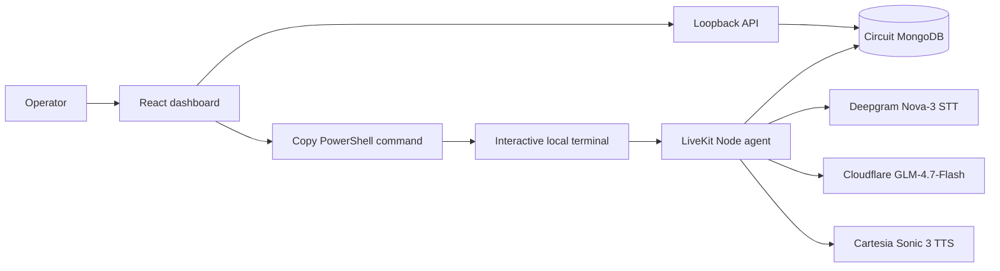

# Voice Audit — Phase 1 as-built handoff

The original Contact/Issue prototype has been replaced by a Ticket-based local audit. The dashboard prepares a command; it does not start an agent or place phone calls. Product Phase 2 outbound calling is not implemented.

## Architecture



The API lists Tickets joined to Customers and handles manual audit submissions. The dashboard stores the selected Ticket IDs in browser memory, in selection order. **Start AI Call** displays two PowerShell lines: a JSON array assigned to `VOICE_AUDIT_TICKET_IDS`, then `pnpm voice`. Copy and paste them into an interactive terminal in this repository. The terminal uses its microphone and speakers. One console session processes the selected tickets sequentially; the listed phone numbers are never dialed.

```mermaid
sequenceDiagram
  participant O as Operator
  participant U as Dashboard
  participant A as Local LiveKit agent
  participant D as Circuit DB
  O->>U: Select 1–10 pending tickets in order
  U->>O: Show copyable PowerShell command
  O->>A: Paste command in local terminal
  loop Each selected ticket
    A->>D: Read Ticket + linked Customer name
    O->>A: Greet or ask who is speaking
    A->>O: LLM introduces Bhavya and asks about resolution
    O->>A: Ask ticket questions or answer yes/no
    A->>D: Complete guarded audit
    A->>O: Thank customer; proceed to next ticket
  end
```

The agent uses Deepgram Nova-3 with `language: "multi"`, Silero VAD, and LiveKit semantic turn detection. It waits for the caller to speak first. Cloudflare receives the full selected Ticket document and the linked customer's name on each turn. Remote-session access URLs, session IDs, and file-storage keys are redacted. The record includes `timestamps.created_at` and `timestamps.closed_at`, so the model can distinguish creation from closure. The record is untrusted data, not instructions; prompt guardrails tell the model not to read internal comments or staff IDs aloud. Its first reply introduces Bhavya from NComputing India, explains the known ticket context, and asks if the issue is resolved. It may answer questions about that ticket from those facts; unrelated questions are redirected to the audit. The first reply has no audit tools available, so a greeting or early yes/no cannot save an audit before the question. Later turns can invoke one of two guarded audit tools for a clear answer. Cloudflare's hidden reasoning is disabled to avoid the observed empty-response token exhaustion; it still generates the conversation and chooses tools. Application code fixes the saved comments: solved is `The query is resolved.`; unsolved is `The issue is not solved`. An unresolved audit reopens the Ticket, clears its former solution and closed workflow timestamps, and leaves `assigned_to` unchanged. It does not ask for another issue description. The linked Customer supplies the name; the agent does not receive the phone number. English and Hindi/Hinglish response handling exist, but other-language spoken output is not guaranteed in this phase.

## Components and configuration

| File | Responsibility |
| --- | --- |
| `src/tickets.ts` | Connect to Circuit models, list audits, join Customer, check eligibility, save audit |
| `src/server.ts` | Loopback `GET /api/audits` and `PATCH /api/tickets/:id/audit` |
| `src/agent.ts` | Interactive audio and sequential per-ticket conversation |
| `src/cloudflare.ts` | Cloudflare LLM request and audit tool descriptions |
| `dashboard/src/` | Audit table, selection, copyable command, manual audit dialog |

Required `.env` values: `CIRCUIT_DB_URL` (same private URI as Circuit's `DB_URL`), `LIVEKIT_URL`, `LIVEKIT_API_KEY`, `LIVEKIT_API_SECRET`, `DEEPGRAM_API_KEY`, `CARTESIA_API_KEY`, `CARTESIA_VOICE_ID`, `CLOUDFLARE_ACCOUNT_ID`, and `CLOUDFLARE_API_TOKEN`. `CLOUDFLARE_AI_MODEL` defaults to `@cf/zai-org/glm-4.7-flash`. Optional voice settings are `CARTESIA_SPEED`, `CARTESIA_VOLUME`, and `CARTESIA_EMOTION`. Old Contact/Issue collections and Contact ID commands are unused.

The API binds only to `127.0.0.1`. Its mutation header `X-Voice-Audit-Local: 1` is not authentication; do not expose the API publicly. There is no queue server or background voice worker. Saved audits persist in Circuit MongoDB. The guarded local writer prevents duplicate local writes, but Circuit's separate manual audit route does not share that atomic guard, so simultaneous writes across the two apps remain a race.

## Run and verify

Run `pnpm api` and `pnpm dev:dashboard` in separate terminals. Select pending tickets in the browser, click **Start AI Call**, copy the shown command, and paste it into a third PowerShell terminal in this repository. The `lk` CLI must be on that terminal's `PATH`. Greet the agent as each selected customer; check that it introduces itself, answers a ticket question from the supplied facts, redirects an unrelated question, and saves an audit only after a clear resolution answer. Verify the dashboard updates. Press Ctrl+C to stop early; generate a fresh command containing only still-pending tickets to resume. Human microphone and provider checks are required before relying on this flow.
