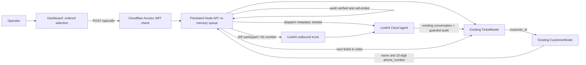

# Voice Audit — outbound calling as-built handoff

## Current scope

The app reads Circuit's existing Tickets and linked Customers. From the Call Audits dashboard an operator selects up to ten pending tickets in a specific order and starts a LiveKit Cloud outbound queue. The server dials the linked Customer's ten-digit Indian number as `+91##########`, runs the existing voice agent, and advances only after the existing Ticket audit has been saved and the agent call has ended.

The calling code and dashboard integration are implemented locally. A local production worker received an outbound call, and Deepgram transcribed the caller's "Hello," but the LLM request timed out before an audit was saved. A complete audit call remains unverified. Hosted deployment requires the configuration below and a human smoke call. No direct call happens from the browser or local `pnpm voice` console.

## Architecture and data flow



```mermaid
sequenceDiagram
  participant O as Operator
  participant D as Dashboard
  participant A as Cloudflare Access
  participant API as Node API
  participant DB as Circuit MongoDB
  participant LK as LiveKit Cloud
  participant Agent as Existing voice agent
  O->>D: Select up to 10 pending tickets in order
  D->>A: POST /api/calls with ticket IDs
  A->>API: Forward authenticated request
  API->>DB: Validate pending Ticket; read linked Customer
  API->>LK: Create room and dispatch one-ticket agent
  LK->>Agent: Job metadata with Ticket ID
  API->>LK: Dial Customer using trunk (+91 + 10 digits)
  Agent->>DB: Existing guarded audit write after clear answer
  API->>DB: Verify audit appended
  API->>LK: Wait for agent to leave; clean up room
  API->>LK: Start next selected ticket only after success
```

## Models and business logic

`TicketModel` and `CustomerModel` are imported from the existing `@circuit/models` package; neither schema is changed. `Ticket.customer_id` links to `Customer._id`. The API reads Customer `name` and `phone_number`, while the agent receives the selected Ticket's existing context. Only the current Ticket's existing guarded audit service writes data. There is no call model, queue collection, migration, or new database write path.

Dispatch metadata selects one Ticket for a cloud job; the legacy local terminal path still uses its environment selection. For SIP calls, LiveKit's telephony background voice cancellation cleans audio before Deepgram and Silero VAD. Silero requires at least 150 ms of speech, uses a 0.6 activation threshold, and waits 500 ms of silence. After the caller joins, the agent speaks a ticket-specific opening after three seconds of no completed speech; an earlier caller utterance triggers the same opening immediately. This opening uses ticket data directly so it does not wait for Cloudflare. Cloudflare still handles later ticket questions and resolved/unresolved decisions. A Cloudflare timeout asks the caller to repeat instead of silently ending the agent. Solved and unsolved audit comments and Ticket status behavior are unchanged.

## API and queue behavior

| Endpoint | Purpose |
| --- | --- |
| `GET /api/audits` | List eligible closed tickets, customer info, metrics, and pages |
| `PATCH /api/tickets/:id/audit` | Existing guarded audit action |
| `POST /api/calls` | Validate and start one ordered queue of 1–10 unique pending Ticket IDs; returns `202` with queue ID |
| `GET /api/calls/:id` | Return queue state and progress for dashboard polling |

Hosted requests require Cloudflare Access JWT signature, issuer, audience, and expiry validation. Browser calls use credentials; the API accepts only the configured dashboard origin for cross-origin access. The API uses LiveKit server credentials, creates a unique room per Ticket, explicitly dispatches `voice-audit-agent` with `{ ticketId }` metadata, waits for the agent, then creates a SIP participant with `waitUntilAnswered`, a 30-second ringing timeout, and a 5-minute maximum call duration.

Exactly ten ASCII digits are accepted for Customer `phone_number`; `+91` is added at dial time. Missing or malformed numbers are not dialed. A no-answer/provider/agent error, call ending before an audit is saved, or timeout stops the queue without writing an audit for that call, retrying, or proceeding to later tickets. Prior successful audits remain saved. Queue progress is in process memory, so the API must be one persistent replica; a restart loses progress and requires operator review before resuming.

## Configuration

Set secrets only in the relevant server/agent deployment secret stores, not in browser variables:

- API and agent: `CIRCUIT_DB_URL`, `LIVEKIT_URL`, `LIVEKIT_API_KEY`, `LIVEKIT_API_SECRET`, `LIVEKIT_OUTBOUND_TRUNK_ID`.
- Existing agent providers: `DEEPGRAM_API_KEY`, `CARTESIA_API_KEY`, `CARTESIA_VOICE_ID`, `CLOUDFLARE_ACCOUNT_ID`, `CLOUDFLARE_API_TOKEN`, and `CLOUDFLARE_AI_MODEL`.
- Hosted API Access: `CLOUDFLARE_ACCESS_TEAM_DOMAIN` and `CLOUDFLARE_ACCESS_AUD`.
- Cross-origin hosting only: `VOICE_AUDIT_DASHBOARD_ORIGIN` on the API and `VITE_API_URL` at dashboard build time. Same-origin hosting can proxy `/api` and leave both unset.

The cloud build needs to resolve sibling `../circuit/packages/models` and `../circuit/packages/utils`; include the Circuit workspace packages in the build context and build their `dist` outputs. No deployment configuration has been applied from this implementation session.

## Changed code ownership

| File | Responsibility |
| --- | --- |
| `src/access.ts` | Verify Cloudflare Access identity for hosted API calls |
| `src/calls.ts` | Validate phone/queue, dispatch agent, dial via trunk, verify audit, stop on failure |
| `src/tickets.ts` | Existing Ticket read/audit operations plus linked Customer phone lookup and audit verification |
| `src/server.ts` | Access/CORS handling and audit/call API endpoints |
| `src/agent.ts` | Use one Ticket ID from LiveKit dispatch metadata, speak the opening promptly, filter telephony noise, and handle later LLM replies/audits |
| `dashboard/src/api.ts` | Call start/status requests and credentialed API access |
| `dashboard/src/App.tsx` | Start queue, show progress/failure and refresh audit data |
| `dashboard/src/types.ts` | Queue API shape |

## Deployment and human verification still required

1. Configure Cloudflare Access application/policy and its audience.
2. Configure the existing LiveKit outbound trunk and agent deployment/secrets; set the corresponding API/agent variables above.
3. Deploy the Node API as one persistent instance, building with the sibling Circuit packages available.
4. Build/deploy the dashboard with same-origin API routing or `VITE_API_URL` and matching `VOICE_AUDIT_DASHBOARD_ORIGIN`.
5. Sign in through Access and use a permitted, consenting test number. Verify one call, saved audit, queue completion, and then a two-ticket queue. Separately verify no-answer and invalid-phone paths stop without mutating the affected Ticket.

Do not use real customer numbers until the provider's consent and calling requirements are satisfied. The implementation does not make phone calls during build/typecheck verification.
