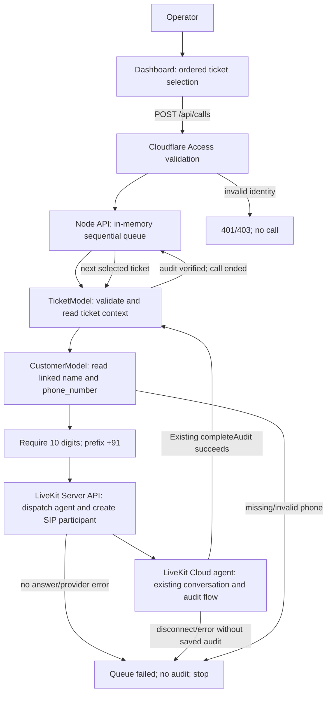
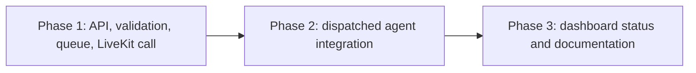

# LiveKit outbound ticket audits — approved implementation plan

## Goal and ownership

Add real outbound calls to V4 while preserving the existing ticket conversation, LLM/STT/TTS configuration, prompts, verdict rules, and audit writer. The dashboard starts an ordered queue of up to ten tickets. The backend reads each ticket and its linked Customer, dials the Customer's Indian mobile number through the configured LiveKit outbound trunk, and advances only after the existing agent saves an audit.

All application changes belong in `voice-audit-system`. Circuit's shared Ticket and Customer models are reused without modification. LiveKit Cloud and Vobiz are configured by the engineer; this plan changes code only and does not deploy services or alter provider settings.

## Locked behavior

- Keep the existing conversation and model flow unchanged: Cloudflare LLM, Deepgram STT, Cartesia TTS, existing prompt, language behavior, and guarded audit decision/write.
- Use `Ticket.customer_id` to read the linked Customer's `name` and `phone_number`. Do not add a phone field to Ticket or create any model/collection.
- Customer phone numbers are stored as exactly ten digits. Prefix `+91` for dialing. Do not guess or rewrite other formats.
- Select and call tickets in dashboard selection order, one call at a time.
- A missing or invalid phone number is not dialed and its Ticket is not changed; stop the queue at that ticket.
- A failed/no-answer call or a call ending without a saved audit stops the queue. Do not write an audit for that call and do not auto-retry. Previously completed tickets remain completed; later tickets are not called.
- A successful call uses the existing `completeAudit` behavior and fixed audit comments. Only after the audit write succeeds and the current call is ended may the next call start.
- Protect cloud API routes with Cloudflare Access identity validation. LiveKit secrets and trunk ID remain backend/agent secrets, never dashboard variables.
- Queue state is in memory. Run the API as one persistent Node service/replica; a process restart loses queue progress, while already-saved Ticket audits remain.
- The cloud build must include or otherwise resolve the current sibling dependency `../circuit/packages/models`. Do not copy or change its schemas.

## Models and database operations

```text
Circuit DB
├── TicketModel #REUSED
│   ├── #READ eligibility, ticket number, issue, solution, timestamps, customer_id
│   └── #WRITE existing internal_information.audit through completeAudit()
└── CustomerModel #REUSED
    └── #READ name and phone_number using Ticket.customer_id
```

No model, collection, index, migration, or schema change. No call/queue records are persisted. Queue progress is process-local; the Ticket audit is the durable outcome.

## Functional flow

```text
[Operator selects up to 10 tickets]
  -> [POST /api/calls with ordered Ticket IDs]
  -> [Cloudflare Access validation]
  -> [Validate all IDs and pending Ticket state]
  -> [Read linked Customer name + phone_number]
  -> [Require 10 digits; prefix +91]
  -> [Dispatch existing agent to a unique LiveKit room]
  -> [Create SIP participant using LIVEKIT_OUTBOUND_TRUNK_ID]
  -> [Existing conversation and guarded audit write]
  -> [End current call; advance to next Ticket]

[Access denied] -> [401/403; no queue or call]
[Missing/invalid phone] -> [Stop at that Ticket; no dial/audit/write]
[No answer/provider/agent failure] -> [Stop; no audit for failed call]
[Call ends without audit] -> [Stop; no audit for failed call]
[Local terminal command] -> [Not used for cloud calls]
```

## File tree

```text
voice-audit-system/
├── package.json                              #MODIFIED — add LiveKit server API, protocol enum, JWT, and shared error-handler dependencies
├── pnpm-lock.yaml                            #MODIFIED — lock the required runtime dependencies
├── .env.example                              #MODIFIED — document trunk, Access, and hosted API settings
├── README.md                                 #MODIFIED — cloud call setup and human smoke instructions
├── docs/
│   └── phase-3-post-implementation.md       #MODIFIED — update architecture and call flow
├── plans/
│   └── livekit-outbound-calling.md          #NEW — approved call-flow implementation plan
├── src/
│   ├── access.ts                             #NEW — verify Cloudflare Access JWT for hosted API requests
│   ├── calls.ts                              #NEW — validate and run a sequential in-memory outbound queue
│   ├── tickets.ts                            #MODIFIED — expose linked Customer phone number to call service
│   ├── server.ts                             #MODIFIED — protect cloud routes and add call start/status endpoints
│   └── agent.ts                              #MODIFIED — accept dispatched ticket metadata while retaining the existing conversation
└── dashboard/
    ├── .env.example                          #MODIFIED — document optional hosted API URL
    └── src/
        ├── api.ts                            #MODIFIED — start call queue and read its status
        ├── App.tsx                           #MODIFIED — wire Start AI Call to cloud queue and show progress/errors
        └── types.ts                          #MODIFIED — add call queue response types

../circuit/packages/models/src/tickets/ticket.model.ts #REUSED — existing Ticket schema
../circuit/packages/models/src/core/customer.model.ts  #REUSED — existing Customer schema
```

No model package source changes. The agent and API deployment must build in a context that resolves `@circuit/models` from the sibling Circuit package (or an equivalent approved package source). This plan does not duplicate model definitions.

## API contracts

All hosted `/api/*` requests require a valid Cloudflare Access JWT. Cloudflare Access policy determines permitted operators; the API validates signature, issuer, audience, and expiry. Existing local development can retain loopback behavior, but a hosted deployment must not bypass Access. Existing audit routes and response payloads remain compatible.

| Method | Path | Access | Request | Success | Failure |
|---|---|---|---|---|---|
| `GET` | `/api/audits` | Cloudflare Access in hosted mode | Existing pagination/date filters | Existing `{ tickets, metrics, total, page, limit, pages }` | `400` invalid filters; `401/403` Access failure; `500` database error |
| `PATCH` | `/api/tickets/:id/audit` | Cloudflare Access in hosted mode plus existing mutation header | Existing `{ verdict, payload }` | Existing `{ ticket }` | Existing validation/write errors plus `401/403` |
| `POST` | `/api/calls` | Cloudflare Access | `{ ticketIds: string[] }` in requested order | `202 { queue: { id, status, ticketIds, currentTicketId, completedTicketIds, failedTicketId, error } }` | `400` malformed/duplicate/out-of-range selection; `409` ineligible ticket or another active queue; `401/403` Access failure; `503` LiveKit setup failure |
| `GET` | `/api/calls/:id` | Cloudflare Access | Queue ID | `200 { queue }` with `running`, `completed`, or `failed` state | `404` unknown queue; `401/403` Access failure |

No existing route is removed. No public unauthenticated route is added. Queue state is only available from the API process that started it.

## Services and validation

| Owner | Function | Arguments | Return | Side effects | Callers |
|---|---|---|---|---|---|
| `access.ts` | Verify Access assertion | Request JWT, expected team domain and audience | Verified identity or typed auth error | Fetch/cache Access JWKS; no business-data writes | Hosted API request guard |
| `tickets.ts` | Extend `getTicketContext` | Ticket ID | Existing ticket/name plus linked phone number | Read Ticket and Customer only | Call queue and agent |
| `calls.ts` | `startCallQueue` | Ordered Ticket IDs | Queue snapshot | Validate 1–10 unique IDs and pending eligibility; reserve and create one active queue | `POST /api/calls` |
| `calls.ts` | Queue runner | Queue ID/state | Updated queue snapshot | For each ticket, dispatch `voice-audit-agent`, place a SIP call, wait for answered/call completion and verify saved audit, then advance or stop | `startCallQueue` |
| `calls.ts` | `getCallQueue` | Queue ID | Queue snapshot | Read process-local queue state | `GET /api/calls/:id`, dashboard polling |
| `server.ts` | Call start/status handlers | HTTP request/queue ID | HTTP status and JSON | Validate body and apply Access guard | Dashboard |
| `agent.ts` | Existing agent entry | LiveKit job metadata containing one Ticket ID and queue/room context | Spoken existing audit flow | Reads the same Ticket context; writes only through existing `completeAudit`; reports normal completion to the queue runner through observable LiveKit/database state | LiveKit Cloud dispatch |

Selection validation: 1–10 unique Mongo IDs, each pending and eligible. Phone normalization accepts exactly ten digits and prepends `+91`; no country-code guessing. A queue start is rejected before dialing if its initial selection is malformed or ineligible. During execution, a missing/invalid number marks the queue failed at that ticket without modifying it. A single active or starting queue is allowed per API process. A failed, unanswered, disconnected-without-audit, or agent-error call stops the queue and does not trigger an audit or retry. The API must independently confirm the Ticket audit was saved before advancing. Use safe error messages; log operational failure details server-side without logging secrets or phone numbers.

Configuration expected by code:

- Existing data/agent secrets: `CIRCUIT_DB_URL`, `DEEPGRAM_API_KEY`, `CARTESIA_API_KEY`, `CARTESIA_VOICE_ID`, `CLOUDFLARE_ACCOUNT_ID`, `CLOUDFLARE_API_TOKEN`, and `CLOUDFLARE_AI_MODEL`.
- LiveKit API service secrets: `LIVEKIT_URL`, `LIVEKIT_API_KEY`, `LIVEKIT_API_SECRET`, and `LIVEKIT_OUTBOUND_TRUNK_ID`. LiveKit Cloud injects its own connection variables into its deployed agent; the API host still needs credentials to dispatch/dial.
- Cloudflare Access validation: `CLOUDFLARE_ACCESS_TEAM_DOMAIN` and `CLOUDFLARE_ACCESS_AUD`; configure the application/policy in Cloudflare Access. Do not expose a shared API key in Vite/browser code.
- Dashboard build: `VITE_API_URL` points to the HTTPS hosted Node API.
- Hosted Node API: listen on the host-provided port and public container interface behind Cloudflare Access. Keep one persistent instance for the in-memory queue.
- Agent runtime: configure the existing model/provider secrets in LiveKit Cloud agent secrets. The source build must resolve the sibling `@circuit/models` dependency.

## E2E smoke path — human-run only

1. **Setup:** Configure the LiveKit outbound trunk and its ID, Cloudflare Access application/audience, hosted Node API secrets, hosted API URL in the dashboard build, and LiveKit Cloud agent secrets. Build from a context that includes `../circuit/packages/models`. Use an approved test customer number with consent and outbound permissions.
2. **Success:** Sign in through Access, select two pending tickets with linked Customers containing ten-digit Indian numbers, and start the queue. Expect one call at a time, `+91` dialing, the unchanged agent conversation, each successful verdict saved using the existing Ticket audit writer, and the second call starting only after the first audit is saved and call ends.
3. **Authorization failure:** Call the start route without a valid Access JWT. Expect `401` or `403`, no queue created, no call, and no Ticket mutation.
4. **Phone validation failure:** Select a ticket with no linked Customer phone or a value other than ten digits. Expect no call to that ticket and no audit/write for it; queue stops there.
5. **Dial failure/no answer:** Use a test destination that will not answer or a deliberately invalid provider destination. Expect queue `failed`, no audit for that call, and no later ticket dialed.
6. **No-verdict disconnect:** Answer, then end the call without giving a clear resolved/unresolved answer. Expect queue `failed`, no audit for that call, and no later ticket dialed.
7. **Cloud dashboard:** Confirm call status moves from running to completed/failed without exposing LiveKit, provider, or database secrets in browser requests or built assets.
8. **Unavailable legacy path:** `pnpm voice` remains a local prototype only; it is not the actual cloud telephony call path.

Do not run this E2E path as part of implementation. The engineer runs it after deployment and reports the result.

## Call-flow diagram



## Phases and orchestration

### Phase 1 — voice-audit-system backend and call queue

Outcome: secure hosted API routes, linked Customer phone lookup, ordered in-memory queue, LiveKit dispatch/SIP call creation, and call outcome checks. Prerequisite: approved API contract and existing Circuit model package. Verification: typecheck/build, inspect that requests cannot reach LiveKit before Access and ticket/phone validation, no new models or writes outside existing audit service.

### Phase 2 — voice-audit-system agent

Outcome: consume one-ticket LiveKit dispatch metadata, run the existing conversation unchanged, and allow the queue to recognize audit success versus call ending without a saved audit. Prerequisite: Phase 1 dispatch metadata contract. Verification: typecheck/build and inspect unchanged instructions, provider setup, and completeAudit path.

### Phase 3 — voice-audit-system dashboard and handoff

Outcome: Start AI Call invokes the cloud queue API and shows selected order, running/completed/failed state, and failure message; documentation records secrets and deployment prerequisites. Prerequisite: Phase 1 route contracts. Verification: dashboard build, request/response type alignment, and no server secrets in Vite variables.

Execution order is sequential; no subagents. Phase 1 defines the queue/dispatch contracts used by Phase 2 and the HTTP contract used by Phase 3. Phase 2 is completed before the dashboard handoff is finalized so its observed success/failure states are represented accurately.



## Assumptions and risks

- `LIVEKIT_OUTBOUND_TRUNK_ID` references the already-created LiveKit outbound trunk and that trunk is configured to route through the user's Vobiz provider. Credentials stored in LiveKit's trunk configuration are not duplicated in app env.
- Cloudflare Access is configured with the intended operator policy; Access JWT validation is performed in the Node API, not trusted solely from browser-supplied headers.
- The hosted API is a persistent Node process with a single replica. In-memory queues are not durable or safe for multiple replicas; restart recovery and multi-replica coordination are out of scope.
- The repository's `@circuit/models` `file:../circuit/packages/models` dependency requires a deployment build context that includes the sibling package. This plan does not copy/publish it or alter schemas.
- Call progress and the existing Ticket audit are separate: only the existing audit write is durable. If the API process restarts during a call, the queue may need operator review before restarting to avoid duplicate calls.
- The user must rotate secrets exposed in the supplied screenshot before any non-sandbox use. Keep credential values out of code, browser bundles, logs, commits, and chat.
