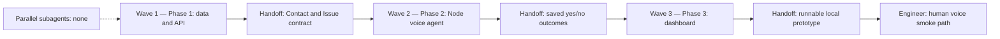
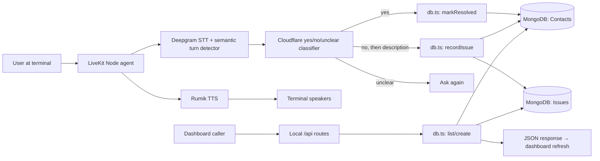

# Local Voice Audit Prototype

## Goal and ownership

Rebuild `voice-audit-system` as a very small local prototype: choose a contact, speak to a Node.js LiveKit agent through the terminal microphone and speakers, answer whether a query was resolved, and see the result on a dashboard. A `no` answer leads to one issue-description question and an Issue linked to the Contact.

`voice-audit-system` owns the agent, local API, MongoDB data, and dashboard. Circuit, Circuit UI, OMS UI, and other repositories are out of scope. Keep the current Git history. Replace the existing application code from scratch while preserving `.env`, `.dev.vars`, and `dashboard/.env` and their values.

“Local” describes the user session and API exposure: LiveKit console mode handles local microphone and speaker I/O, and the API listens on `127.0.0.1`. Deepgram, Cloudflare Workers AI, and Rumik remain external model services. Console mode needs no phone number, outbound trunk, or WebRTC room.

## Functional features and exclusions

1. Create and select a simple Contact before starting a terminal voice session.
2. Ask whether the query was resolved. A clear `yes` marks the Contact `resolved`; an unclear answer prompts the user to answer again without writing a result.
3. A clear `no` asks for a spoken issue description, stores one Issue linked to that Contact, and marks the Contact `needs_escalation`.
4. Show Contacts, their latest resolution status, and linked Issues on a small dashboard that refreshes every few seconds.

The spoken flow is fixed and has only two steps. Cloudflare `@cf/openai/gpt-oss-20b` classifies the first answer as `yes`, `no`, or `unclear`; it does not decide database operations or invent the issue description. Save the final Deepgram transcript of the issue description, after trimming and validation.

Excluded: Python, LangChain, Tasks, outbound calling, SIP trunks, call providers, LiveKit room dispatch, external escalation delivery, authentication/roles, recordings, transcript history, analytics, retries, and settings UI. The agent may say it has noted an issue for escalation, but the prototype only marks it for manual follow-up in the dashboard.

## Models and ownership

Use a fresh MongoDB database, `voice_audit_local`, through the existing `MONGODB_URI`; do not drop or migrate the old `voice_audit_system` database. Keep the models in `src/db.ts` to avoid a service/model layer for this small prototype.

```text
MongoDB / voice_audit_local
├── contacts #NEW
│   ├── _id: ObjectId                                      #WRITE #READ
│   ├── name: nonempty string                               #WRITE #READ
│   ├── resolutionStatus: pending | resolved | needs_escalation
│   │                                                       #WRITE #MODIFY #READ
│   └── createdAt, updatedAt: Date                          #WRITE #MODIFY #READ
└── issues #NEW
    ├── _id: ObjectId                                      #WRITE #READ
    ├── contactId: ObjectId → contacts._id                  #WRITE #READ
    ├── description: nonempty string                        #WRITE #READ
    └── createdAt: Date                                    #WRITE #READ
```

MongoDB supplies the `_id` indexes. Add only `issues.contactId` for linked-issue reads. Names are not unique. A Contact can have multiple Issues over separate sessions; each session writes at most one final outcome. The Contact status represents the latest outcome. No `#DELETE` model operation is part of the prototype: old database records remain untouched, and the new collections have no delete endpoint. The old Task *code* and its call fields are removed.

The Contact update and Issue insert for a `no` result run in one MongoDB transaction. Request and agent code validate inputs; database schema validators are deferred for this prototype. MongoDB's separate Issue collection is justified by the requested independent issue list and the possibility of more than one issue per Contact.

## File tree

This is the intended implementation tree. `#DELETED` applies to application code after the plan is approved, not to the current planning step. Untracked/generated Python and Wrangler caches can be removed after their exact paths are checked; they are not part of the model or API.

```text
voice-audit-system/
├── .env                                   #REUSED — preserve current values
├── .dev.vars                              #REUSED — preserve current values
├── .env.example                           #MODIFIED — document the smaller setup
├── .gitignore                             #REUSED — keep secrets and build output ignored
├── README.md                              #NEW — three local run commands and prerequisites
├── package.json                           #MODIFIED — Node agent and local API scripts
├── pnpm-lock.yaml                         #MODIFIED — new dependencies
├── pnpm-workspace.yaml                    #MODIFIED — retain dashboard workspace
├── tsconfig.json                          #MODIFIED — Node configuration
├── wrangler.toml                          #DELETED — old Worker setup
├── agent/
│   ├── agent.py                           #DELETED — old Python agent
│   ├── config.py                          #DELETED — old Python configuration
│   └── requirements.txt                   #DELETED — old Python dependencies
├── src/
│   ├── agent.ts                           #NEW — console session and two-step conversation
│   ├── rumik-tts.ts                       #NEW — Rumik audio adapter for LiveKit
│   ├── db.ts                              #NEW — Contact and Issue types and persistence
│   ├── server.ts                          #NEW — three local dashboard routes
│   ├── index.ts                           #DELETED — old Worker entry
│   ├── types.ts                           #DELETED — old Task types
│   ├── config/agent-config.ts             #DELETED — old call configuration
│   ├── db/mongo.ts                        #DELETED — old database setup
│   ├── models/contact.model.ts            #DELETED — replaced by db.ts
│   ├── models/task.model.ts               #DELETED — Task model removed
│   ├── routes/contacts.route.ts           #DELETED — old API
│   ├── routes/tasks.route.ts              #DELETED — old API
│   ├── schemas/contact.schema.ts          #DELETED — old input shape
│   ├── schemas/task.schema.ts             #DELETED — Task input
│   ├── services/contact.service.ts        #DELETED — old service
│   ├── services/task.service.ts           #DELETED — Task service
│   ├── services/call-orchestrator.service.ts #DELETED — call flow
│   ├── services/livekit-client.service.ts #DELETED — call flow
│   └── utils/http.ts                      #DELETED — old Worker helper
├── dashboard/
│   ├── .env                               #REUSED — preserve current values
│   ├── .env.example                       #MODIFIED — local API setting
│   ├── package.json                       #REUSED — React and Vite
│   ├── index.html                         #MODIFIED — prototype title
│   ├── tsconfig.json                      #REUSED — browser configuration
│   ├── vite.config.ts                     #MODIFIED — proxy local API
│   └── src/
│       ├── main.tsx                       #MODIFIED — mount new screen
│       ├── App.tsx                        #NEW — contact form, selection, and results
│       ├── api.ts                         #NEW — local API calls
│       ├── types.ts                       #MODIFIED — Contact and Issue view types
│       ├── styles/index.css              #MODIFIED — simple responsive layout
│       ├── vite-env.d.ts                  #REUSED — Vite types
│       ├── components/task-table.tsx      #DELETED — old call UI
│       ├── pages/tasks-page.tsx           #DELETED — old Task screen
│       └── services/voice-audit.service.ts #DELETED — old API client
└── plans/
    ├── voice-audit-system.md              #DELETED — obsolete plan, during implementation
    └── local-voice-audit.md               #NEW — this approved rebuild plan
```

`src/rumik-tts.ts` is the only provider-specific adapter needed because the LiveKit Node.js TTS plugin list does not currently document Rumik. Use Rumik's documented Silk API and convert its returned 24 kHz audio into the frames required by LiveKit. Use LiveKit's Node Deepgram plugin, Silero VAD, and local `v1-mini` semantic turn detector. In `agent.ts`, call Cloudflare's OpenAI-compatible Chat Completions endpoint directly for the small classifier; a separate orchestration library is unnecessary.

## Routes and exact API contracts

The API listens on `127.0.0.1` only. The Vite dashboard calls it through its development proxy. Dates in JSON are ISO 8601 strings. `Contact` is `{ id: string, name: string, resolutionStatus: "pending" | "resolved" | "needs_escalation", createdAt: string, updatedAt: string }`. `Issue` is `{ id: string, contactId: string, description: string, createdAt: string }`.

| Method | Path | Auth/role | Request | Success response | Failure responses |
|---|---|---|---|---|---|
| `POST` | `/api/contacts` | No role; loopback only | JSON `{ "name": "Asha" }` | `201 { "contact": Contact }` with `resolutionStatus: "pending"` | `400 { "error": string }` for malformed JSON or invalid name; `500 { "error": string }` for storage failure |
| `GET` | `/api/contacts` | No role; loopback only | No body or query | `200 { "contacts": Contact[] }`, newest first | `500 { "error": string }` for storage failure |
| `GET` | `/api/issues` | No role; loopback only | No body or query | `200 { "issues": Issue[] }`, newest first | `500 { "error": string }` for storage failure |

Unknown paths return `404 { "error": "Not found" }`. No session/call endpoint exists: the terminal command selects a Contact by ID, for example `VOICE_AUDIT_CONTACT_ID=<id> pnpm voice`. The LiveKit CLI runs `src/agent.ts` in local console mode, and the agent reads that Contact directly.

Remove `/contacts`, `/tasks`, `/tasks/:taskId`, `/tasks/:taskId/call`, and `/health`. This is an intentional breaking change for the fresh prototype. The old dashboard and any old clients must not call these paths. No compatibility adapter is planned.

## Services, validation, and error handling

| Owner | Function | Arguments | Return | Side effects | Callers |
|---|---|---|---|---|---|
| `db.ts` | `createContact` | trimmed name | Contact | insert Contact | `POST /api/contacts` |
| `db.ts` | `listContacts` | none | Contact[] | read Contacts | `GET /api/contacts` |
| `db.ts` | `listIssues` | none | Issue[] | read Issues | `GET /api/issues` |
| `db.ts` | `getContact` | Contact ID | Contact or null | read Contact | agent startup |
| `db.ts` | `markResolved` | Contact ID | updated Contact | set status and `updatedAt` | agent `yes` branch |
| `db.ts` | `recordIssue` | Contact ID, description | Issue | transaction: insert Issue and set Contact status | agent `no` branch |
| `agent.ts` | `classifyAnswer` | final transcript | `yes`, `no`, or `unclear` | Cloudflare model request | first voice step |
| `agent.ts` | `runConversation` | selected Contact ID | session outcome | STT, turn detection, spoken prompts, one final write | terminal command |
| `rumik-tts.ts` | `synthesize` | text | LiveKit audio frames | Rumik Silk request | agent speech output |
| `server.ts` | route handlers | HTTP request | JSON response | call `db.ts`; no voice dispatch | dashboard |

Validate a trimmed Contact name of 1–80 characters and a trimmed issue description of 1–1000 characters. Check that the selected Contact ID is a valid MongoDB ObjectId and exists before starting audio. Validate Cloudflare output against the exact three-value enum; empty, malformed, contradictory, or failed responses become `unclear`. Do not update MongoDB on `unclear` or an empty issue description; ask again. The issue description is the user's transcript, not an LLM rewrite.

Maintain a per-session state (`awaiting_resolution`, `awaiting_issue`, `finished`) and a busy guard so duplicate final-transcript events do not cause duplicate writes. `recordIssue` uses a MongoDB transaction for its two writes. A model, speech, or database failure reports a short safe error and does not mark the Contact resolved. Do not log secrets or full transcripts. The prototype has no identity/role checks because the API is bound to the local loopback interface. There are no external downstream actions beyond STT, LLM, and TTS requests.

Use the existing `MONGODB_URI`, `DEEPGRAM_API_KEY`, `RUMIK_API_KEY`, `CLOUDFLARE_ACCOUNT_ID`, and `CLOUDFLARE_API_TOKEN`. Keep `CLOUDFLARE_AI_MODEL=@cf/openai/gpt-oss-20b`. Preserve other existing env values even if console mode does not use them. Document optional `VOICE_AUDIT_DB=voice_audit_local` and the per-command `VOICE_AUDIT_CONTACT_ID` without writing a real Contact ID into `.env`.

## Human E2E smoke path

Only the engineer runs and signs off on these spoken end-to-end cases. Automated typechecks, builds, and focused non-E2E checks during implementation do not replace the human voice result.

| Case | Setup | Action | Expected API/database result | Expected voice/dashboard result |
|---|---|---|---|---|
| Resolved | Start MongoDB, API, dashboard; create Contact A; set `VOICE_AUDIT_CONTACT_ID` to A | Start `pnpm voice`; answer “yes” | `contacts[A].resolutionStatus = resolved`; no Issue inserted | Agent acknowledges; dashboard refresh shows Resolved |
| Needs escalation | Create Contact B and select B | Start voice; answer “no”; describe an issue | Exactly one Issue with `contactId = B`; Contact B is `needs_escalation`; both writes commit together | Agent asks for the issue, acknowledges it; dashboard shows status and description |
| Unclear answer | Create Contact C and select C | Start voice; say an ambiguous answer | Contact C remains `pending`; no Issue inserted | Agent asks yes/no again |
| Empty description | Create Contact D and select D | Say “no,” then give no usable issue description | Contact D remains `pending`; no Issue inserted | Agent asks for the description again |
| Invalid contact input | API and dashboard running | Submit a blank Contact name | `POST /api/contacts` returns `400`; no Contact inserted | Form shows an error; list does not gain a row |
| Local boundary | API bound to `127.0.0.1` | Try its port from another machine | No remote connection; no database change | No remote dashboard API access |
| Removed call flow | API running | Request old `/tasks` or `/tasks/:id/call` path | `404`; no Task or call created | No Play/call control on dashboard |

The compact approved path is:

```text
[Add contact] -> [201 pending] -> [Terminal voice] -> [yes] -> [Contact resolved] -> [Dashboard refresh]
[Pending contact] -> [Terminal voice] -> [no] -> [Issue description] -> [Issue + needs_escalation] -> [Dashboard refresh]
[Unclear] -> [Ask again] -> [No write]
[Blank name] -> [400] -> [No contact]
[Remote machine] -> [Loopback API unavailable]
[Old call endpoint] -> [404]
```

## Delivery phases

| Phase | Outcome | Prerequisites | Verification |
|---|---|---|---|
| Phase 1 — `voice-audit-system` data/API | Preserve env files and Git history; remove old Worker, call, Python, and Task code; add fresh Contact/Issue persistence and three local routes | Locked models and routes | Typecheck and focused API contract checks; inspect diff to confirm secrets and old DB are untouched |
| Phase 2 — `voice-audit-system` voice agent | Terminal microphone session with Deepgram, Silero, semantic turns, Cloudflare classification, Rumik speech, and final writes | Phase 1 `db.ts` contract | Typecheck and focused classification/state checks; confirm agent starts with a selected Contact |
| Phase 3 — `voice-audit-system` dashboard | Create/select Contacts and show status and Issues with periodic refresh | Phase 1 API and Phase 2 result shape | Dashboard build and local route checks; engineer performs the human spoken E2E smoke path |

## Agent orchestration

One implementer executes three sequential waves. There are no subagents: the codebase and contracts are small, and the voice/dashboard phases share the new data shape. The Phase 1 handoff is the Contact/Issue types and routes; the Phase 2 handoff is the final outcome behavior; Phase 3 consumes both. The engineer's spoken smoke test follows implementation.



## Caller-to-response flow



## Assumptions, risks, and locked decisions

- The same local Git repository path is used with fresh application code. Git history and all three real env files remain intact; no GitHub remote is created by this plan.
- A fresh `voice_audit_local` database avoids changing old contacts/tasks or requiring a migration. The old database is not deleted.
- LiveKit console mode is the terminal microphone/speaker transport; it does not use a LiveKit Cloud room. The external model APIs still require network connectivity and valid keys.
- Rumik has a documented REST/WebSocket Silk API, but the LiveKit Node.js plugin catalog does not list Rumik. The small adapter and its audio-frame conversion are the main integration risk; verify this in Phase 2 before UI polish. Do not silently replace Rumik with a different provider.
- The Cloudflare classifier can misunderstand speech. Enum validation and an `unclear` fallback prevent ambiguous or failed classification from changing Contact or Issue data.
- MongoDB transactions require a transaction-capable deployment. Confirm this during Phase 1 before relying on the atomic `no` path.
- The dashboard polls the local API every few seconds. It shows loading, empty, error, and responsive states and keeps Contact selection visible. The terminal command shown for a selected Contact is copied or run manually; the dashboard does not start the microphone.
- New local API paths intentionally break the old Task/Worker dashboard contract. No outbound calling, retry, or compatibility layer is planned.

## Technical references checked during planning

- [LiveKit console startup modes](https://docs.livekit.io/agents/server/startup-modes/)
- [LiveKit Node Deepgram integration](https://docs.livekit.io/agents/integrations/stt/deepgram/)
- [LiveKit semantic turn detector](https://docs.livekit.io/agents/logic/turns/turn-detector/)
- [Cloudflare GPT-OSS-20B model](https://developers.cloudflare.com/workers-ai/models/gpt-oss-20b/) and [OpenAI-compatible endpoint](https://developers.cloudflare.com/workers-ai/configuration/open-ai-compatibility/)
- [Rumik Silk API](https://rumik.ai/silk-api/)
