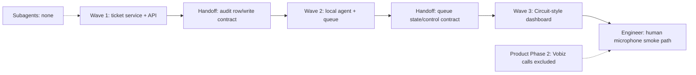
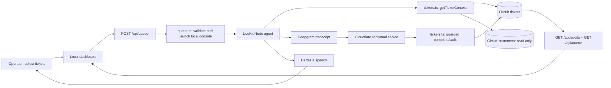

# Ticket-based local AI audits — approved enhancement plan

> **Phase 1 revision (2026-10-16):** The dashboard no longer launches or controls a background worker. **Start AI Call** only displays a copyable two-line PowerShell command containing the ordered selection of 1–10 Ticket IDs. The operator pastes it into an interactive terminal, where `pnpm voice` processes those tickets sequentially. The former `src/queue.ts`, `/api/queue` routes, and Pause/Retry/Skip controls described in the historical plan below are superseded and are not part of the as-built system. See the [as-built handoff](../docs/phase-3-post-implementation.md) and [run instructions](../README.md) for the current flow.

> **Opening-question revision (2026-10-16):** The LLM no longer composes the first question. The agent speaks the fixed Bhavya/NComputing India template from known Ticket and Customer fields. Cloudflare remains only for interpreting the reply or asking for clarification. The historical LLM-opening descriptions below are superseded.

> **Conversation correction (2026-10-16):** This supersedes the preceding opening-question revision. The agent waits for the caller to speak, then Cloudflare composes Bhavya's introduction and ticket-specific resolution question from bounded Ticket/Customer facts. The LLM also answers only ticket-relevant questions and redirects unrelated ones. The first reply has no audit tool access; later clear resolution answers use the existing guarded tools and writes.

> **Ticket-context expansion (2026-10-16):** The caller requested the selected Ticket's full document as LLM context, superseding the bounded-facts description above and below. The linked Customer still contributes only the name. Remote-session URLs, session IDs, and file-storage keys are redacted before sending to Cloudflare; the rest of the Ticket, including creation and closure timestamps, is supplied each turn. Audit writes and tool guards are unchanged.

## Goal and boundary

Replace the voice-audit prototype's Contact/Issue workflow with a Circuit-style Call Audits dashboard and a local, sequential AI voice queue. An operator selects up to ten pending, closed tickets, clicks **Start AI Call**, and speaks as each customer through the computer's terminal microphone. The agent uses the ticket and linked customer context to ask if the query is resolved, then completes the audit on the shared Circuit ticket. Product Phase 2 outbound calls through Vobiz are explicitly excluded from this plan.

The plan lives **only in `voice-audit-system`**, as requested. Phase 1 changes source code only there. `circuit/packages/models` supplies the existing Ticket and Customer schemas; `circuit/apps/operations` supplies the audit behavior to match; `circuit-ui` supplies the visual reference. No Circuit, Circuit UI, or OMS UI source change is planned.

## Current and expected flow

```text
Current:
[Create Contact] -> [One local terminal session] -> [Contact/Issue write] -> [Session closes]

Expected:
[Select 1–10 pending tickets] -> [Start AI Call in local dashboard]
-> [One local console session; operator speaks as each customer]
-> [Personalized question from customer name + ticket issue/closed date/solution]
-> [Solved] -> [Audit verdict true + "The query is resolved."] -> [Thank you]
-> [Unsolved] -> [Audit verdict false + "The issue is not solved"]
              -> [Reopen ticket, keep assignee] -> [Apology/technical-team closing]
-> [Next selected ticket in order]

[Worker error or operator pause before an audit is saved]
-> [No guessed verdict] -> [Queue paused] -> [Retry same ticket or Skip it]
```

The unresolved path does **not** ask for an additional issue description. The closing must not claim that a new technician was assigned, because Phase 1 leaves `assigned_to` unchanged and sends no new assignment. Approved meaning: “I've marked your query as unresolved for the technical team. Sorry for the inconvenience, and thank you.” The existing English/Hindi/Hinglish models and language helper remain; eleven-language routing is not added here. The phone number is displayed but never dialed.

## Observable features and exclusions

1. Reproduce the Circuit Call Audits screenshot's desktop structure and visual treatment in the standalone dashboard: sidebar, heading, date filter, four metrics, ticket table, pagination, ticket details/solution, and manual Complete audit dialog. Include customer name and phone by reading the linked Customer; add responsive layouts for narrower screens.
2. Select up to ten eligible tickets in a defined order. A Start AI Call button launches one local terminal audio session; the queue advances after each successfully saved and spoken closing. Show current/completed/skipped state and Pause, Retry, and Skip controls.
3. The agent reads ticket number, customer name, closed date, issue type, and solution; the LLM composes a short, accurate resolution question. A clear answer invokes an application-guarded audit write, not an LLM database write.

Excluded: SIP/Vobiz/outbound dialing, browser microphone transport, customer record writes, a new Contact or Issue collection, a new technician assignment or notification, hosted agent deployment, authentication middleware, and changes to Circuit's existing app routes or UI. The standalone API remains bound to `127.0.0.1`; this is not a public-service security model.

## Ownership and file tree

`voice-audit-system` owns the local UI, routes, services, queue process, agent, documentation, and configuration. Circuit owns the shared schemas and continues to consume the same ticket records. Circuit UI is a visual/behavioral reference only. OMS UI is not affected.

```text
voice-audit-system/
├── package.json                         #MODIFIED — link @circuit/models and expose local queue startup
├── pnpm-lock.yaml                       #MODIFIED — record the shared-model dependency
├── .env.example                         #MODIFIED — document CIRCUIT_DB_URL and local-only settings
├── README.md                            #MODIFIED — ticket-based local runbook
├── docs/
│   └── phase-3-post-implementation.md  #MODIFIED — update the old as-built handoff after implementation
├── src/
│   ├── db.ts                             #DELETED — remove Contact/Issue persistence
│   ├── tickets.ts                        #NEW — shared-model connection, ticket/customer reads, guarded audit write
│   ├── queue.ts                          #NEW — local worker lifecycle and in-memory queue controls
│   ├── server.ts                         #MODIFIED — replace Contact/Issue routes with audit/queue routes
│   ├── agent.ts                          #MODIFIED — ticket context and sequential local conversations
│   ├── cloudflare.ts                     #MODIFIED — ticket-audit tools and prompt contracts
│   ├── language.ts                       #REUSED — existing English/Hindi reply selection
│   ├── tickets.test.ts                   #NEW — audit eligibility and write-state checks
│   └── queue.test.ts                     #NEW — progress/pause/retry/skip checks
└── dashboard/src/
    ├── App.tsx                           #MODIFIED — Circuit-style audit page and queue controls
    ├── api.ts                            #MODIFIED — audit and queue client calls
    ├── types.ts                          #MODIFIED — audit/queue response types
    └── styles/index.css                 #MODIFIED — match Call Audits visual treatment and responsive states

circuit/packages/models/src/tickets/ticket.model.ts  #REUSED — Ticket schema; no source change
circuit/packages/models/src/core/customer.model.ts   #REUSED — Customer schema; no source change
circuit/apps/operations/src/services/audit.service.ts #REUSED — behavior reference; no source change
circuit-ui/src/pages/TicketAuditPage.tsx              #REUSED — visual reference; no source change
```

The new `tickets.ts` centralizes the only shared-database access in this app; the new `queue.ts` is justified by the dashboard-triggered local worker and its pause/retry/skip state. Tests target the two new stateful boundaries. Do not copy Circuit model definitions into this repo. Linking `@circuit/models` may require building that package as a local prerequisite, but does not authorize modifying Circuit source.

## Models and database operations

The local service uses `CIRCUIT_DB_URL`, copied privately from Circuit's `DB_URL`, rather than the prototype's `MONGODB_URI`/`VOICE_AUDIT_DB` default. Keep existing real env values intact until the new path is verified. Reuse one Mongoose connection per process; add no speculative pool or timeout overrides for this low-concurrency local prototype.

```text
Circuit database
├── tickets — TicketModel #REUSED
│   ├── _id, ticket_number, customer_id, status                     #READ
│   ├── technical_information.type_of_issue                         #READ
│   ├── timestamps.closed_at                                         #READ #MODIFY-on-unsolved
│   ├── internal_information.solution.payload/out_of_scope         #READ #MODIFY-on-unsolved
│   ├── internal_information.audit[]                                 #READ #MODIFY
│   ├── internal_information.comments[]                              #MODIFY-on-unsolved
│   ├── timestamps.updated_at and other workflow timestamps          #MODIFY
│   └── assigned_to                                                  #READ, never modify
└── customers — CustomerModel #REUSED
    └── _id, name, phone_number                                      #READ only
```

No new schema fields, indexes, collections, migration, or `#DELETE` operation are planned. A fresh Ticket audit entry is `{ status: true, verdict: boolean, payload: string, created_at: Date }`. Solved leaves the ticket closed and retains its solution. Unsolved matches Circuit's current audit behavior: append the failed-audit comment, reopen the ticket, clear the previous solution/closed workflow timestamps, and leave `assigned_to` untouched. The standalone writer must condition its write on a closed, in-scope ticket whose latest audit is pending, so it does not duplicate its own result. Circuit UI's existing manual writer is not a shared atomic lock: simultaneous auditing from that app remains a known cross-app race.

## Local HTTP routes and exact contracts

Bind the API to `127.0.0.1`; use actual HTTP status codes with `{ "error": string }` on failures. No authentication middleware. Mutation routes accept JSON and require a custom header (for example `X-Voice-Audit-Local: 1`), with no cross-origin permission granted. This blocks a simple cross-origin browser form, but does not protect against other trusted local programs. Do not expose the API on a public interface. Customer PII should not be cached in a public response.

`AuditRow` is `{ id, ticket_number, customer_name, phone_number, closed_at, issue, solution, audit }`, where nullable customer/issue/solution fields show `—` in the UI rather than being invented. `audit` is `{ status: boolean, verdict: { status: boolean | null, comment: string }, created_at: string | null }`. `metrics` is `{ pending_audits, completed_audits, problem_solved, problem_unsolved }`. `Queue` is `{ status: "idle" | "running" | "paused" | "finished", ticketIds: string[], currentTicketId: string | null, completedTicketIds: string[], skippedTicketIds: string[], error: string | null }`.

| Method | Path | Auth/role | Request | Success response | Failure responses |
|---|---|---|---|---|---|
| `GET` | `/api/audits` | Loopback; no role | Query `page` positive integer, `limit` positive integer, optional ISO `from`/`to`; default page 1 and limit 10 | `200 { "tickets": AuditRow[], "metrics": metrics, "total": number, "page": number, "limit": number, "pages": number }` | `400` invalid filters; `500` database error |
| `PATCH` | `/api/tickets/:id/audit` | Loopback + mutation header | JSON `{ "verdict": boolean, "payload": string }`; payload trimmed/nonempty | `200 { "ticket": { "id": string, "status": string, "assigned_to": string \| null, "audit": AuditRow["audit"] } }` | `400` malformed input/ID; `404` missing ticket; `409` not pending/eligible; `500` write error |
| `POST` | `/api/queue` | Loopback + mutation header | JSON `{ "ticketIds": string[] }`; 1–10 unique valid IDs in selected order | `202 { "queue": Queue }` | `400` malformed/duplicate IDs; `409` active queue or ineligible ticket; `503` immediate worker launch failure |
| `GET` | `/api/queue` | Loopback; no role | No body | `200 { "queue": Queue }` | `500` unexpected error |
| `POST` | `/api/queue/pause` | Loopback + mutation header | No body | `200 { "queue": Queue }` with paused state after stopping the active worker | `409` not running; `500` stop failure |
| `POST` | `/api/queue/retry` | Loopback + mutation header | No body | `200 { "queue": Queue }` with current ticket retried | `409` not paused or already saved; `500` restart failure |
| `POST` | `/api/queue/skip` | Loopback + mutation header | No body | `200 { "queue": Queue }` with current ticket skipped and next running, or finished | `409` not paused; `500` restart failure |

Unknown routes return `404 { "error": "Not found" }`. The previous `/api/contacts` and `/api/issues` intentionally disappear; their clients must be replaced. The agent calls the shared local service directly, while the manual Complete audit dialog uses the PATCH route. Both follow the same eligibility and write rules. The queue response is process-local and disappears when the API restarts; saved Ticket audits remain in MongoDB.

## Services, guards, and failure handling

| Owner | Function | Arguments | Return | Change / side effects | Callers |
|---|---|---|---|---|---|
| `tickets.ts` | `connectTicketDb` | `CIRCUIT_DB_URL` | shared model connection | Open once per API/agent process; fail closed if absent/wrong DB | ticket functions |
| `tickets.ts` | `listAudits` | page, limit, from, to | rows + metrics + pagination | Read eligible Ticket rows and linked Customers | GET audits |
| `tickets.ts` | `getTicketContext` | ticket ID | pending ticket context or typed error | Read Ticket and Customer; no write | queue validation, agent |
| `tickets.ts` | `completeAudit` | ticket ID, verdict, fixed/manual payload | updated Ticket audit summary | Guard pending/closed/in-scope; append one audit; unsolved reopens/clears solution; preserve assignee | agent, PATCH audit |
| `queue.ts` | `startQueue` | ordered ticket IDs | Queue | Validate all IDs, launch one local console worker, hold in-memory state | POST queue |
| `queue.ts` | `getQueue` | none | Queue | Reconcile worker status with saved Ticket audits | GET queue/UI polling |
| `queue.ts` | `pauseQueue`, `retryQueue`, `skipTicket` | current Queue | Queue | Stop/restart local worker or advance without writing a verdict | queue control routes |
| `agent.ts` | `runNextTicket` | current Ticket context | spoken outcome | Ask contextual question, use guarded LLM tool choice, call `completeAudit`, speak closing, advance | local console session |

The AI audit payload is fixed: solved uses `The query is resolved.` and unsolved uses `The issue is not solved`. The LLM receives only the details needed to phrase the question—ticket number, name, close date, issue type, and bounded solution text—not the phone number. Ticket solution text is untrusted data, never instructions. Model output cannot bypass the application stage and eligibility checks. Empty/ambiguous transcripts do not write an audit. Queue start rejects duplicate or ineligible IDs; an active queue cannot be started again. If an audit is saved but speech/worker fails, reconciliation treats the saved result as completed rather than retrying the write. If no audit was saved, the queue pauses on the current ticket and offers Retry or Skip. API restart loses queue state, not committed audits. Avoid logging credentials, full phone numbers, or full transcripts.

The dashboard needs loading, empty, error, and responsive states; selection and queue progress remain visible while lists refresh. A row displays the ticket details/solution and a manual audit dialog. Preserve the reference page's desktop layout closely, adding only the selection and AI queue controls needed for this prototype. Selection order determines conversation order. A missing linked Customer or solution must produce a safe fallback prompt rather than fabricated details.

## Human-only E2E smoke instructions

These are instructions for the engineer, not test results. Automated typechecks/unit tests do not replace microphone testing.

| Case | Setup | Action | Expected API/database result | Expected UI/voice result |
|---|---|---|---|---|
| Solved then unsolved | Two distinct eligible closed Tickets with linked Customers | Select both, start queue; answer yes for first and no for second | First audit `status=true, verdict=true, payload="The query is resolved."`; ticket stays closed. Second audit `status=true, verdict=false, payload="The issue is not solved"`; ticket reopens, old solution clears, `assigned_to` unchanged | Agent uses each name/issue/solution accurately, says approved closings, advances in selected order; metrics/rows update |
| Pause and retry | One pending Ticket | Start session, pause before verdict, then Retry and answer clearly | No audit on pause; exactly one audit after retry | Queue shows paused, then running, then finished |
| Pause and skip | Two pending Tickets | Pause first before verdict, Skip it, answer second | First remains pending; second gets one audit | Queue records first as skipped and starts second |
| Invalid/duplicate selection | API running | Submit missing, already-audited, or repeated Ticket ID | `400` or `409`; no worker and no database write | Clear error; selected rows remain for correction |
| Manual/AI local conflict | One pending Ticket | Attempt manual completion while AI attempts the same Ticket | Local guarded writer accepts one result and rejects the other with `409`; no second local audit | Dashboard refresh shows the saved result; queue pauses/reconciles safely |
| Missing optional context | Closed eligible Ticket with no linked Customer or solution | Start a single-ticket queue | One audit only after a clear answer | Agent uses ticket number and available facts; never invents name/solution |
| Local boundary | API bound to loopback | Try remote access or an old Contact/Issue route | Remote access unavailable; old routes return `404`; no write | No phone call or old Contact/Issue UI |

## Implementation waves, estimates, and orchestration

These are implementation waves **within product Phase 1**, not the later Vobiz calling phase. One implementer proceeds sequentially; no subagents because the service, queue, and agent share state and contracts.

| Wave | Outcome | Prerequisite | Owned files | Non-E2E verification | Estimate |
|---|---|---|---|---|---|
| 1 — Ticket data/API | Shared-model connection, read rows, guarded audit write, local routes | `CIRCUIT_DB_URL` available; approved contracts | `tickets.ts`, `server.ts`, package/env files, focused tests | Typecheck, focused service/route tests, compare unsolved writes to Circuit service | 20–30 min |
| 2 — Agent and queue | One terminal console worker, sequential ticket conversations, pause/retry/skip | Wave 1 service/result shape | `agent.ts`, `cloudflare.ts`, `queue.ts`, focused tests | Typecheck and deterministic queue/state checks; inspect child-process failure path | 45–60 min |
| 3 — Dashboard | Circuit-style table, context view, multi-select, start and queue controls | Wave 2 routes and queue contract | dashboard files, README/handoff docs | Dashboard build, loading/empty/error/responsive review, diff audit | 30–45 min |



## Caller-to-response dependency flow



## Risks, compatibility, and locked decisions

- `circuit` and `circuit-ui` source remain untouched. The new app depends on their shared model package and the actual Circuit database. A wrong `CIRCUIT_DB_URL` must fail visibly before any audit write; do not silently fall back to `voice_audit_local`.
- The local API has no account/role middleware by request. Loopback binding, JSON/custom-header mutation checks, and no CORS permission reduce browser exposure but are **not authentication**. Do not deploy this API publicly or expose customer phone numbers without a security redesign.
- Circuit's existing manual audit route is not a cross-app atomic lock. Simultaneous Circuit UI and voice-audit writes to the same Ticket can race; Phase 1 prevents duplicate writes only inside the new local service.
- [LiveKit console mode](https://docs.livekit.io/agents/server/startup-modes/) uses the local microphone and speakers and is a single local session. The queue switches ticket context within that session; it does not dial each phone number. Worker lifecycle and pause/retry behavior need focused implementation checks and the engineer's spoken smoke test.
- Ticket solution notes can be missing or inaccurate. The LLM may phrase the question but must not invent facts, follow instructions embedded in solution text, or decide database writes without application guards.
- The queue is in API memory; API restart discards it. Saved audit records remain. Starting a fresh queue after restart must revalidate eligibility rather than replay completed tickets.
- The date filter and dashboard metrics should mirror Circuit's closed, in-scope audit meaning. The visual layout is adapted to this standalone app; Circuit UI itself is not edited.
- No external reassignment, notification, Vobiz trunk, outbound call, expanded multilingual STT/TTS, or data migration is authorized by this Phase 1 plan.
